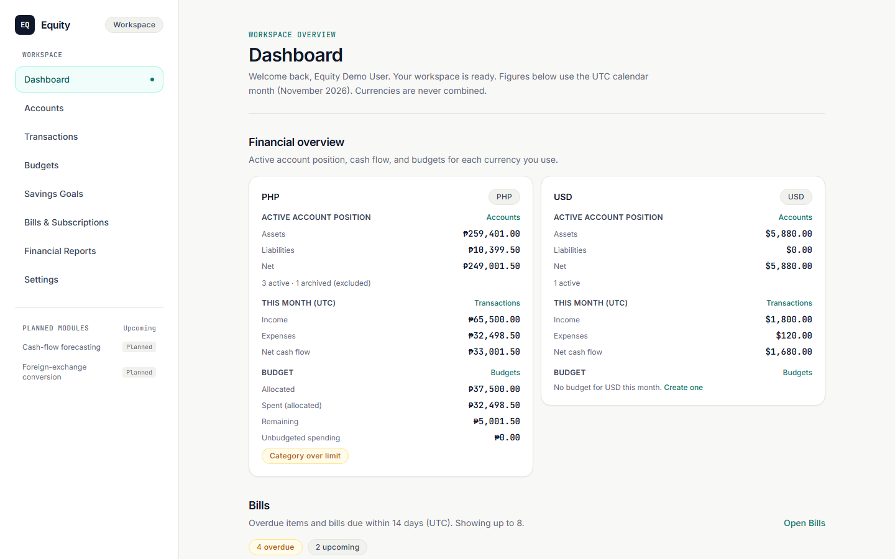
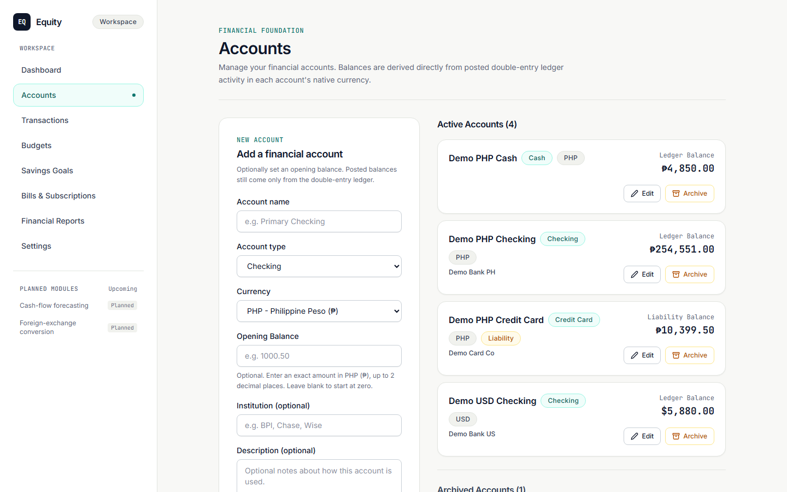
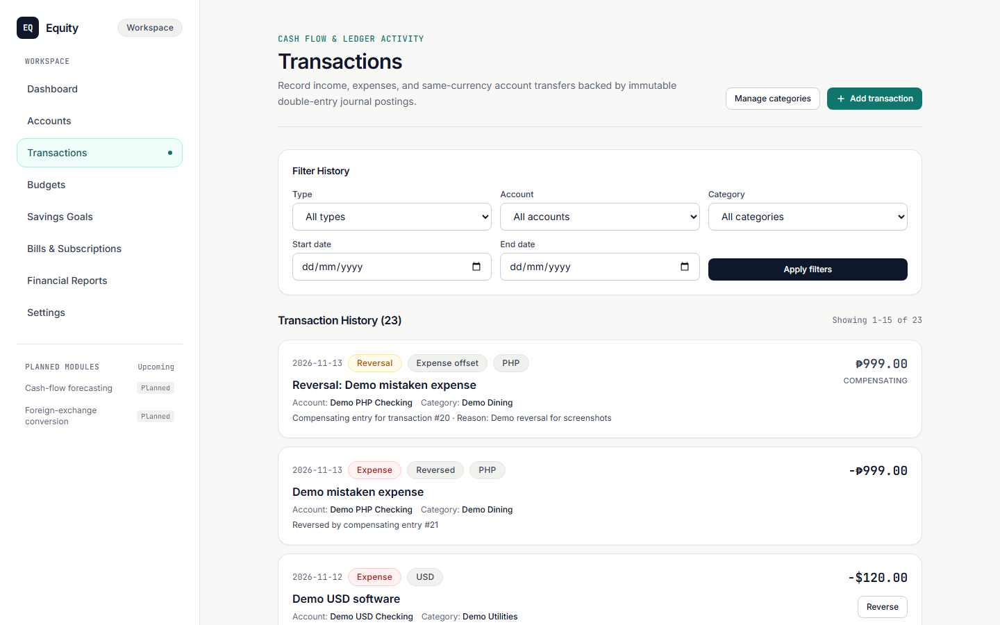
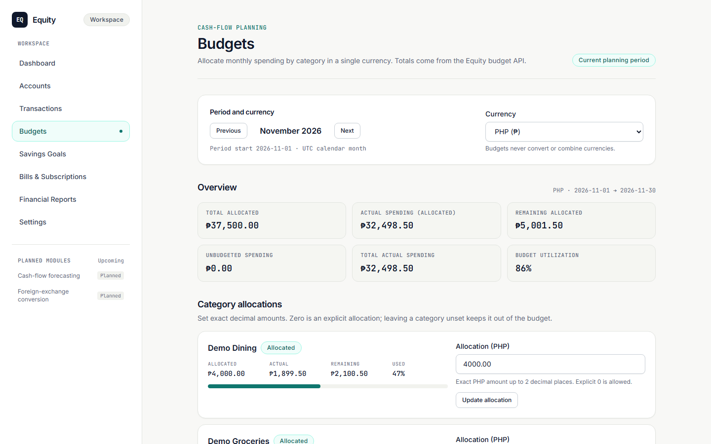
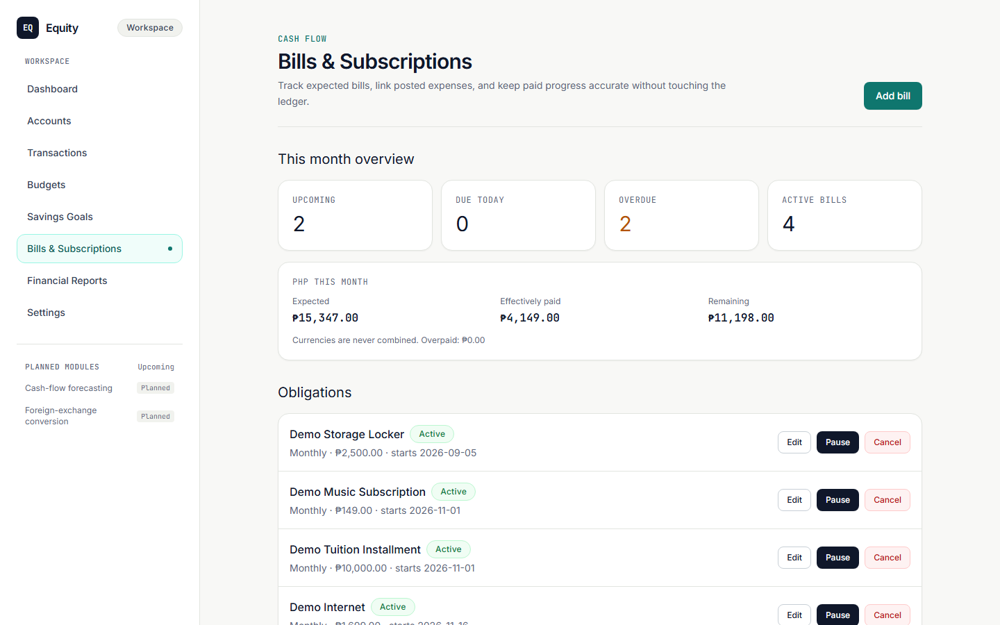
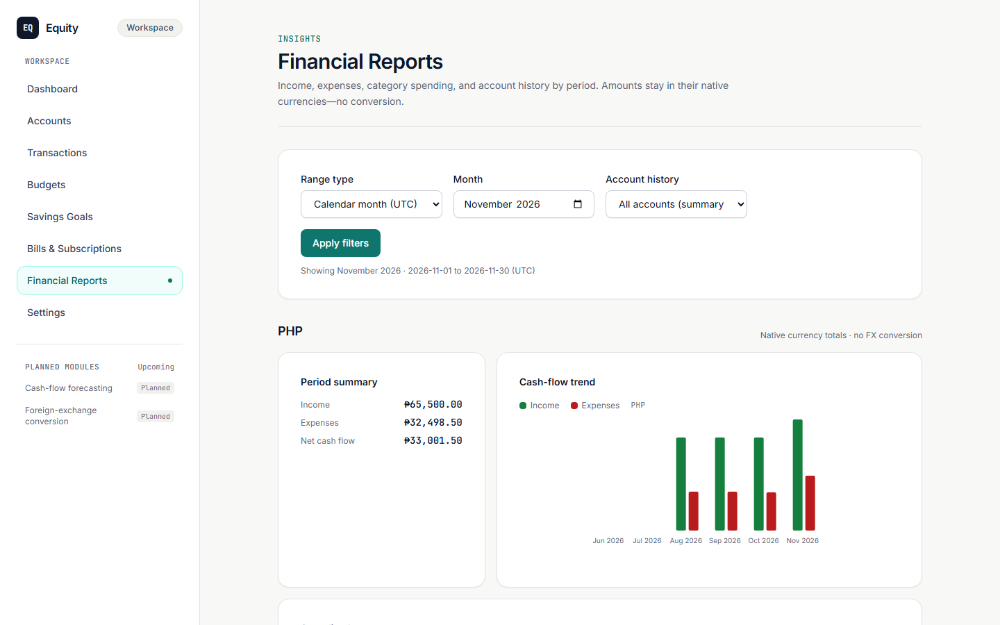
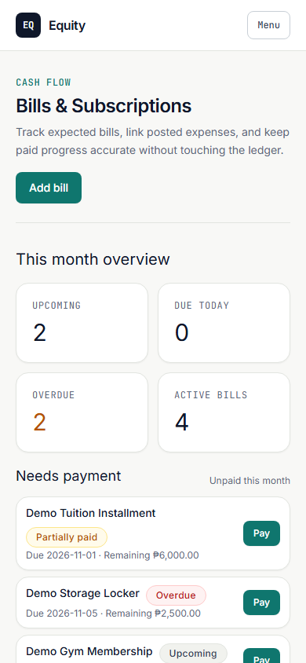

# Equity

Personal finance, clearly understood.

Equity is a personal finance management application built with Laravel, React, TypeScript, and Inertia.js. It brings accounts, transactions, budgets, recurring bills, savings goals, and financial reports into one interface, backed by a double-entry accounting system designed for financial accuracy and traceability.

Repository: [https://github.com/devtdlv/equity](https://github.com/devtdlv/equity)

## Screenshots

| Dashboard | Accounts |
| :-------: | :------: |
|  |  |

| Transactions | Budgets |
| :----------: | :-----: |
|  |  |

| Bills & Subscriptions | Financial Reports |
| :-------------------: | :---------------: |
|  |  |

| Mobile — Bills |
| :------------: |
|  |

Screenshot sources and capture notes: [`docs/screenshots/`](docs/screenshots/README.md).

## Features

### Dashboard

Authenticated workspace overview with **per-currency** summaries (currencies are never combined):

- Active account position (assets, liabilities, net)
- Current UTC-month income, expenses, and net cash flow
- Budget allocated / spent / remaining, including **Category over limit** vs **Budget over limit** badges
- Bills needing attention (overdue and upcoming)
- Links into each implemented module

### Accounts

Create and manage checking, savings, cash, credit card, and other accounts. Balances are derived from posted ledger activity—not stored as editable totals. Opening balances post once through the ledger. Archive/restore instead of destructive delete; currency and asset/liability classification become immutable after postings exist.

### Transactions

Record income, expenses, and same-currency transfers. Reversals post compensating journal entries.

### Budgets

Monthly expense targets by category, kept separate per currency. UI currency selection syncs to the URL so Back/Forward/refresh restore the selected currency.

### Bills & Subscriptions

Recurring obligations and occurrence tracking.

- **Pay** posts an expense and links it to the occurrence in one atomic operation (defaults to remaining balance; overpayment blocked).
- **Link payment** associates an existing expense without posting a new one.
- On mobile, a **Needs payment** shortcut surfaces unpaid occurrences near the top of the page.

### Savings Goals

Create, edit, archive, and restore goals. Allocations are earmarks recorded as goal events—they do **not** move money between financial accounts or change ledger balances.

### Financial Reports

Read-only monthly or custom UTC ranges with per-currency income/expense summaries, cash-flow trend charts, category spending, and optional account history. Transfers and reversals are excluded from activity totals. Foreign-exchange conversion and CSV export are not implemented.

### Settings & authentication

Session registration, login, logout, and password reset. Settings covers profile (name/email) and password changes. Email addresses are not verified in the current application.

## Financial integrity

Equity treats money as a correctness problem first:

| Concern | Approach |
| ------- | -------- |
| **Double-entry ledger** | Every posted journal entry balances (`total_debits === total_credits > 0`) in a single currency |
| **Monetary precision** | Signed 64-bit integer minor units end to end—no binary floating-point arithmetic for money |
| **Idempotency** | Create/post flows use client UUID keys with request fingerprinting; conflicts surface instead of silent duplicates |
| **Atomic posting** | Related writes (for example bill pay-and-link) run inside a single financial database transaction |
| **Derived balances** | Account balances come from aggregated journal postings, not mutable balance columns |
| **Audit trail** | Append-only `audit_events` with sensitive-key redaction and model-level immutability |
| **Posted immutability** | Posted journal entries are protected in application code and with database triggers |

Reference currencies: `PHP`, `USD`, `AUD`, `EUR`, `GBP`, `JPY` (ISO 4217 table; seeded via `CurrencySeeder`).

## Stack

| Layer | Choice |
| ----- | ------ |
| Backend | PHP 8.2+, Laravel 12 |
| Frontend | React 19, TypeScript (strict), Inertia.js v3 |
| Styling | Tailwind CSS v4, Vite 6 |
| Database | File-based SQLite by default; optional MySQL/MariaDB |
| Quality | Laravel Pint, ESLint 9, Prettier 3, `tsc --noEmit` |

## Testing

Automated tests are part of normal development:

- **Backend:** Pest feature and unit tests (isolated SQLite `:memory:`)
- **Frontend:** Vitest + React Testing Library + jsdom
- **Browser tooling:** Playwright scripts for visual-audit captures and focused browser regression checks (not a full end-to-end suite)
- **Focused domains:** `php artisan test tests/Feature/Finance` for ledger and money paths; Vitest page/utility suites for UI behavior

Hardening checklist and smoke journey notes: [`docs/release-readiness.md`](docs/release-readiness.md).

## Getting started

Fresh checkout (do **not** overwrite an existing `.env` or `database/database.sqlite`):

```bash
composer install
npm install
cp .env.example .env
php artisan key:generate
```

Create the SQLite database file only if it does not already exist:

```bash
# Unix / macOS / Git Bash
[ -f database/database.sqlite ] || touch database/database.sqlite
```

Platform-specific SQLite creation (Windows PowerShell), optional MySQL/MariaDB, email/log password reset, migration inventory, and the bills occurrence scheduler: [`docs/local-setup.md`](docs/local-setup.md).

```bash
php artisan migrate
php artisan db:seed --class=CurrencySeeder
```

**Serve with built assets:**

```bash
npm run build
php artisan serve
```

**Local development with Vite** (Laravel and Vite in separate processes, or together):

```bash
composer run dev
# or separately:
php artisan serve
npm run dev
```

```bash
php artisan test
npx vitest run
npx tsc --noEmit
```

## Planned (not implemented)

- Cash-flow forecasting
- Foreign-exchange conversion between currencies

These appear as **Planned** in the authenticated shell and are not available as routes or services.

## Documentation

| Doc | Contents |
| --- | -------- |
| [`docs/local-setup.md`](docs/local-setup.md) | Install, database, scheduler, quality commands |
| [`docs/architecture.md`](docs/architecture.md) | Ledger model and module roles |
| [`docs/release-readiness.md`](docs/release-readiness.md) | Hardening checklist and smoke journey |
| [`docs/visual-audit/`](docs/visual-audit/README.md) | Isolated screenshot environment |
| [`docs/screenshots/`](docs/screenshots/README.md) | README screenshot sources |
